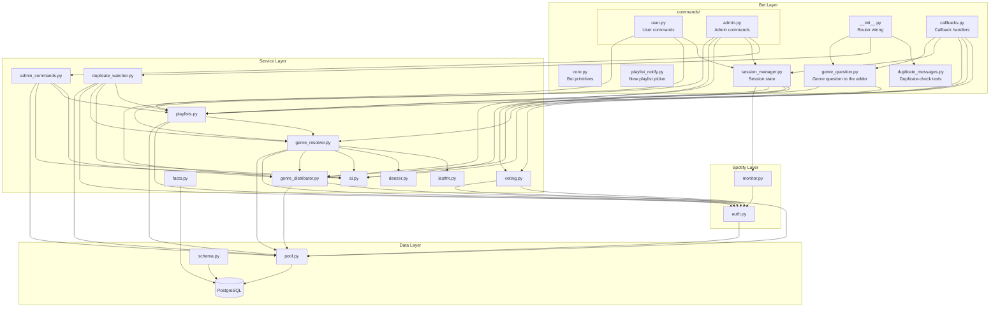

# Modules & Services

## Architecture Diagram



## Module Details

### Bot Layer

| File | Lines | Responsibility |
|------|-------|----------------|
| `app/bot/__init__.py` | 189 | Router wiring, `setup_bot()` |
| `app/bot/core.py` | 151 | `bot`, `dp`, `pool`, `is_admin`, `is_registered`, `extract_spotify_id`, decorators (`@require_admin`, `@require_registered`, `@require_admin_callback`), message helpers (`send`, `reply`, `send_photo`, `reply_photo`, `edit_text`, `edit_caption`), `safe_int`, `parse_turdom_number` |
| `app/bot/session_manager.py` | 695 | `SessionManager` singleton: all session state, `on_track_change`, `end_session`, `check_session_complete`, `finalize_track_card`, `update_vote_buttons`, `recover`, `send_recap_carousel`, `cache_pre_recap_teaser` |
| `app/bot/callbacks.py` | 654 | All `callback_query` handlers: voting, skip, regen_facts, approve/deny, session control, recap carousel, playlist creation, history pagination, duplicate «Удалить»/«Оставить», genre question |
| `app/bot/playlist_notify.py` | — | Admin picker for who gets notified about a new playlist: `offer_notification`, `handle_callback` |
| `app/bot/genre_question.py` | 239 | Asks whoever added a track for its genre when nobody else knows it (all 11 genres) or Last.fm and Deezer disagree with no word from Claude (only the genres they named): genre buttons with ticks, «Сохранить», «Не знаю»; the answer names where the track goes (`ask_genre`, `handle_callback`) |
| `app/bot/duplicate_messages.py` | 118 | Texts of the duplicate-check messages (auto-removed, possible duplicate, dropped before, modified version); escapes every name |
| `app/bot/commands/user.py` | 799 | `/start`, `/reg`, `/next`, `/get`, `/genres`, `/check`, `/stats`, `/mystats`, `/history`, `/join`, `/leave`, `/secret` |
| `app/bot/commands/admin.py` | 758 | `/auth`, `/session`, `/preview`, `/reschedule`, `/scan`, `/import`, `/import_all`, `/distribute`, `/recap`, `/close_playlist`, `/create_next`, `/health`, `/dbinfo`, `/backfill_genres` |
| `app/config.py` | — | Pydantic settings (env vars) |
| `app/main.py` | — | Entry point, pool + schema init |

### Service Layer

| File | Responsibility | Depends On |
|------|----------------|------------|
| `app/services/voting.py` | Vote recording, threshold calculation, track removal, skip | auth.py, pool |
| `app/services/playlists.py` | Playlist import, duplicate check, «Оставить» decisions (`kept_duplicates`), create/reschedule | auth.py, genre_resolver.py, pool |
| `app/services/admin_commands.py` | Post-session commands: distribute, recap, close, create_next, dbinfo | genre_distributor.py, playlists.py, ai.py, pool |
| `app/services/genre_distributor.py` | Genre classification (GENRE_MAP), the tag saved for each genre a person picks (PICK_TAGS), distribute tracks to genre playlists | auth.py, pool |
| `app/services/genre_resolver.py` | Track genre: keeps a saved one, else Claude decides with Last.fm (track, else artist) tags and the Deezer release genre as hints, and without Claude they decide when they agree. They disagree when each names a genre the other does not say, not even as a broader or more exact one: then `GenreDisputed` when someone can be asked, with the first source's genre saved meanwhile (if it could be saved), else the first source decides. `GenreLookupFailed` when nothing was found and a source did not answer; a source with no key, a refused key or no credit counts as absent. Saves a genre a person picked (`genre_approved`) over one the bot found, never over a pick already made; backfill | lastfm.py, deezer.py, genre_distributor.py, ai.py, auth.py, playlists.py (`extract_isrc`, imported lazily: playlists imports this module), pool |
| `app/services/deezer.py` | Deezer API client, no key: the genre of a track's release by ISRC, as tags the genre playlists know; «Alternative», a compilation or someone else's release decides nothing; tells «knows nothing» (`[]`) from «did not answer» (`None`) | httpx |
| `app/services/lastfm.py` | Last.fm API client: genre tags of a track or an artist; tells «knows nothing» (`[]`) from «did not answer» (`None`) | httpx |
| `app/services/ai.py` | Claude Sonnet: track facts, recap, teaser (no fallback); `ask_claude` for short questions such as a genre | anthropic |
| `app/services/facts.py` | Hand-written track facts: list tracks without facts, check Telegram HTML, save (CLI: `python -m app.services.facts`) | asyncpg (own pool for the CLI) |
| `app/services/duplicate_watcher.py` | Background: poll playlists, detect duplicates, auto-remove, ask whoever added a track for its genre when nobody knows it or the sources disagree, generate AI facts | playlists.py, ai.py, genre_resolver.py, auth.py, pool |

### Spotify Layer

| File | Responsibility |
|------|----------------|
| `app/spotify/auth.py` | OAuth flow, token refresh/persistence, get_spotify() client |
| `app/spotify/monitor.py` | Playback polling (4s), track change/pause/resume detection |

### Data Layer

| File | Responsibility |
|------|----------------|
| `app/db/pool.py` | asyncpg connection pool (min=2, max=5) |
| `app/db/schema.py` | Table definitions, versioned migrations via `schema_version` table (70 migrations) |

## In-Memory State (SessionManager)

`SessionManager` is a singleton class (`session` instance) in `session_manager.py`. All session state is encapsulated:

```python
session_id: int | None
playlist_id: str | None
current_session_track_id: int | None
participants: set[int]                    # telegram_ids
track_messages: dict[int, list[tuple[int, int]]]  # session_track_id -> [(chat_id, msg_id)]
played_track_ids: set[str]               # guard: don't re-vote same track
skip_in_progress: set[int]               # guard: race condition on skip
cached_pre_recap: str | None             # pre-generated teaser
session_message: tuple[int, int] | None
waiting_theme: bool
```

**Recovered on restart** from `sessions` WHERE status='active' via `SessionManager.recover()`.

## Background Tasks

| Task | Trigger | Interval |
|------|---------|----------|
| DuplicateWatcher | Bot startup | Variable: 1h (Tue-Wed), 5h (Mon), 12h (Thu-Sun) |
| SpotifyMonitor | `/session` start | 4 seconds polling |
| AI Facts Generator | DuplicateWatcher cycle | Per-track, for upcoming playlist |
